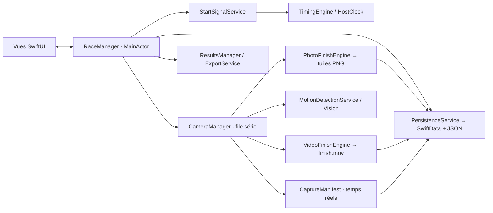

# Architecture de SprintTimer

## Choix d’ensemble

SprintTimer utilise Swift 6, SwiftUI, SwiftData, AVFoundation, Core Image et ImageIO. UIKit fournit les exports PDF/PNG et la feuille de partage. Vision intervient uniquement dans le filtre facultatif de présence humaine du mode instantané. Aucun package distant n’est nécessaire ; `Packages/SprintTimerCore` est un package Swift local, partagé entre l’application et ses tests.

L’organisation suit MVVM : les vues présentent l’état de `RaceManager`, qui orchestre les services. Les moteurs de chronométrage, de pixels et de détection ne dépendent pas des vues. Le projet `SprintTimer.xcodeproj` et le schéma partagé sont versionnés. `scripts/generate_project.py` permet de régénérer leur structure de manière déterministe ; il n’est pas nécessaire de l’exécuter pour ouvrir le projet.



## Composants réels

| Composant | Emplacement | Responsabilité |
| --- | --- | --- |
| `SprintTimerApp` | `SprintTimer/App` | Création du conteneur SwiftData et présentation de l’accueil ; message de récupération si le stockage ne s’ouvre pas. |
| `RaceManager` | `SprintTimer/ViewModels` | État observable de la course, départ, capture, résultats, sauvegarde et cycle de vie. |
| `CameraManager` | `SprintTimer/Services` | Session AVFoundation, sélection du format, conversion des temps, distribution aux moteurs et signalement des interruptions/pertes. |
| `HostClock` | `SprintTimer/Services` | Lecture de l’horloge hôte Core Media. |
| `StartSignalService` | `SprintTimer/Services` | Bip WAV original, lecture programmée, écoute du microphone et premier échantillon dépassant le seuil. |
| `TimingEngine` | `SprintTimerCore` | Départ/arrêt/réinitialisation, origine monotone et décalage temporel. |
| `FrameTimeline` | `SprintTimerCore` | Validation de la chronologie, recherche d’une image, correspondance pixel–temps, intervalle maximal et cadence observée. |
| `PhotoFinishEngine` | `SprintTimer/Services` | Extraction BGRA, composition par tuiles de 256 bandes au plus et écriture PNG sans perte. |
| `PhotoFinishRaster` | `SprintTimerCore` | Opérations de référence sur rasters RGBA : extraction et composition sous limite de mémoire, utilisables sans caméra. |
| `VideoFinishEngine` | `SprintTimer/Services` | Encodage continu H.264 dans un conteneur MOV ; refus d’images lorsque l’encodeur est occupé. |
| `MotionDetectionService` | `SprintTimerCore` | Différence de luminance dans une zone, seuil, front de mouvement, délai et réarmement. |
| `ResultsManager` | `SprintTimerCore` | Classement stable par temps et génération CSV avec échappement des champs. |
| `PersistenceService` / `RaceFiles` | `SprintTimer/Services` | Index SwiftData, documents JSON, récupération des points de reprise et suppression des médias. |
| `ExportService` | `SprintTimer/Services` | CSV, PDF paginé, PNG annoté et partage des originaux. |

`HomeView` gère l’historique ; `NewRaceView` configure la course, dont sa date et son heure ; `RaceView` présente le déroulement et l’analyse. `PhotoStripView` affiche les tuiles à la demande dans une pile horizontale paresseuse. `VideoReviewView` demande une image vidéo à l’instant sélectionné et contrôle son temps de décodage. `ResultEditView` modifie l’attribution et le temps.

## Concurrence et états

`RaceManager`, la persistance SwiftData et les exports graphiques sont isolés au `MainActor`. `CameraManager` confine la session, les moteurs média et le détecteur à une seule file série dédiée. Les buffers caméra sont traités immédiatement et ne forment pas une file d’attente non bornée. Les événements vers l’interface sont livrés dans leur ordre d’émission, pour conserver notamment la dernière arrivée avant l’événement de fin.

Les états `RacePhase` sont `preparing`, `ready`, `armed`, `countdown`, `running`, `recording`, `processing` et `finished`. Les messages d’erreur et de sauvegarde sont distincts de cette phase. Le chronomètre commence avant la capture des arrivées ; la durée de capture maximale s’applique à partir de la première image enregistrée.

Le compte à rebours utilise une échéance hôte et une tâche annulable. Le départ sonore est programmé légèrement à l’avance. Le départ microphone est armé explicitement après autorisation et utilise un verrou ponctuel pour qu’un même signal ne déclenche pas plusieurs départs. Au passage en arrière-plan, le départ en attente est annulé ; une course active est arrêtée et les médias sont finalisés. La capture ne continue pas écran verrouillé.

Les annotations `@unchecked Sendable` des adaptateurs AVFoundation reposent sur la confinement à la file de capture, ou sur le verrou dédié au déclenchement audio. Elles ne rendent pas les objets AVFoundation librement partageables entre files.

## Origine temporelle commune

`HostClock.now` lit `CMClockGetTime(CMClockGetHostTimeClock())`. Le moteur logique reçoit des secondes issues de cette horloge, sans consulter la date civile.

Pour un événement de départ `S` et un décalage `O` :

```text
origine = S − O
temps de l’image = horodatage_hôte_de_l’image − origine
```

Un décalage positif recule donc l’origine et augmente le résultat. Un second départ est ignoré jusqu’à la réinitialisation. L’arrêt fige le temps ; une nouvelle tentative crée un nouvel identifiant de course en conservant l’ancienne.

Pour chaque image, `CameraManager` lit le PTS du `CMSampleBuffer`, puis le convertit de `session.synchronizationClock` vers l’horloge hôte avec `CMSyncConvertTime`. Le manifeste conserve le PTS original, le temps hôte converti et le temps depuis le départ. La date configurable d’une course sert au classement de l’historique, jamais à mesurer une arrivée.

Le microphone utilise le temps hôte du tampon audio et ajoute l’indice du premier échantillon qui dépasse le seuil, divisé par la fréquence d’échantillonnage. Le bip utilise son instant de lecture programmé. Les latences physiques d’entrée et de sortie, la propagation acoustique et la réaction humaine restent à calibrer sur appareil : le code ne les mesure pas automatiquement.

## Moteur de photo-finish

1. Sélectionner un format arrière compatible avec la cadence demandée, jusqu’à 240 i/s, et une résolution comprise dans les bornes de capture du projet. La cadence réellement choisie est renvoyée à l’interface.
2. Orienter les buffers vers le portrait lorsque cette rotation est prise en charge. La prévisualisation utilise la même géométrie pour aligner la ligne.
3. Lire une bande verticale de 1 à 16 pixels à la position configurée. Le calcul respecte `bytesPerRow`, donc le padding éventuel du buffer caméra.
4. Copier la bande dans une tuile de capacité 256 bandes, de gauche à droite dans l’ordre de capture.
5. Rendre la partie remplie de la tuile avec Core Image et l’écrire en PNG sans perte via ImageIO. La dernière tuile peut comporter moins de 256 bandes.
6. Enregistrer les métadonnées de tuile et tous les temps associés dans `capture.json`. L’affichage assemble visuellement les fichiers par ordre chronologique.

Le tampon principal contient au plus `256 × largeur_bande × hauteur × 4` octets. Des copies et objets temporaires existent pendant le rendu PNG ; la liste d’horodatages et de tuiles croît avec la capture. La mémoire des bandes ne croît pas avec toute la durée de course. L’écriture et le rendu peuvent ralentir la file de capture : AVFoundation est configuré pour écarter les images arrivées trop tard et les pertes signalées sont comptées.

La largeur et la position de bande sont fixes pendant l’enregistrement. Le zoom est un agrandissement de consultation. Aucun re-rendu avec une nouvelle largeur n’est disponible après capture, car le mode photo ne conserve ni image pleine ni vidéo complète. Les tuiles sont les pixels sources conservés pour l’analyse.

Une bande choisie retourne son horodatage stocké. Si deux bandes sont séparées par une lacune, cette durée reste visible ; le moteur ne déduit pas de temps par `index / FPS` et n’interpole pas le franchissement. `actualFPS` est une moyenne calculée sur les temps enregistrés, pas une preuve d’un débit constant.

## Vidéo et arrivée instantanée

`VideoFinishEngine` enregistre une vidéo **continue** H.264, sans réordonnancement d’images, plafonnée à 60 i/s par la configuration. Le PTS de la première image fixe le début du fichier. Une image n’est ajoutée au manifeste vidéo que si l’encodeur l’a acceptée. Le score de mouvement est conservé pour chaque image ; il ne sert pas à supprimer les séquences calmes. L’analyse sélectionne les images enregistrées, sans interpolation vidéo.

Lors d’un changement d’image sélectionnée, le marquage est désactivé jusqu’à la fin du décodage. `AVAssetImageGenerator` utilise des tolérances de recherche nulles ; le résultat doit correspondre à l’instant demandé à 3 ms près. En cas d’écart supérieur, d’échec ou de fichier absent, le marquage reste désactivé et un message est affiché. Ce seuil vérifie la correspondance entre image et PTS du fichier ; il ne certifie pas la précision du chronométrage physique.

Le détecteur compare 24 × 48 échantillons de luminance dans la zone verticale autour de la ligne. Le score est la différence absolue moyenne, normalisée entre 0 et 1. Une valeur dépassant le seuil peut déclencher une arrivée. Deux images calmes sont nécessaires pour réarmer le détecteur, en plus de la temporisation entre déclenchements. Une entrée pendant la temporisation ne doit pas produire un résultat retardé lorsque ce délai expire.

En mode instantané, Vision peut confirmer la présence d’une personne dans la zone au moment d’un déclenchement. Ce contrôle ne suit pas le torse ni l’identité d’un concurrent. Les temps enregistrés portent la source **Mouvement (estimation)**. La vidéo de contrôle permet de reprendre le marquage ; lorsque l’encodeur refuse une image au moment d’une détection, le temps peut être conservé sans indice d’image.

## Persistance et récupération

`StoredRace` est un modèle SwiftData contenant l’identifiant unique, le nom, la date et un document Codable sérialisé. `RaceDocument` regroupe réglages, participants, résultats et manifeste de capture. Les versions de document et de manifeste sont actuellement fixées à 1.

Le stockage média est relatif à l’espace de l’application :

```text
Application Support/
  Races/<UUID>/
    race.json
    capture.json
    photo-00000.png ...      # photo-finish
    finish.mov              # vidéo ou instantané
```

Chaque sauvegarde écrit atomiquement `race.json`, puis met à jour SwiftData. Pendant la capture photo, un point de reprise est écrit après chaque tuile finalisée ; il ne revendique que les bandes déjà durables. Pendant la capture vidéo, le manifeste est réécrit environ toutes les deux secondes. Un point de reprise porte `interrupted = true` jusqu’à une finalisation réussie.

À la réouverture, `PersistenceService.recover` peut récupérer le dernier `capture.json` en complément du document indexé. Cela ne constitue pas une transaction unique entre base, JSON et médias. Après un arrêt brutal, jusqu’à 255 bandes en attente et les écritures en cours peuvent être perdues ; un MOV non finalisé peut rester illisible malgré la présence du manifeste. Les noms et résultats déjà sauvegardés restent dans le document de course.

La suppression d’une course retire d’abord ses médias puis l’entrée SwiftData. Aucun mécanisme d’import/restauration des originaux partagés ou de synchronisation iCloud n’est actuellement fourni.

## Exports

- Le CSV est UTF-8, avec séparateur virgule, fins de ligne CRLF, champs échappés et temps décimal indépendant de la locale. Les champs texte susceptibles d’être interprétés comme des formules sont protégés par une apostrophe.
- Le PDF est paginé et inclut résultats, sources, statistiques de capture et limites de précision.
- Le PNG est un aperçu annoté, borné à 16 000 pixels de large et environ 16 mégapixels de contenu. Les tuiles originales ne sont pas modifiées.
- Le partage des originaux remet les JSON et les médias existants à `UIActivityViewController`. Ces fichiers conservent les temps par image ; le PNG d’aperçu ne remplace pas les métadonnées.

Les exports graphiques sont préparés sur le `MainActor` ; un indicateur affiche leur préparation. Pour les longues captures, cette opération peut mobiliser l’interface jusqu’à la fin du rendu. Un traitement d’export davantage déporté reste une amélioration possible.

## Tests et frontière de validation

Les 20 tests du package vérifient les règles temporelles, l’offset, les chronologies irrégulières, les pixels des bandes, le détecteur et le CSV. Les 10 tests iOS couvrent l’adaptateur BGRA/PNG, le changement de tuile, la persistance, les exports et la vidéo. `VideoFinishEngineTests` encode réellement trois images synthétiques aux PTS irréguliers 1000,000 / 1000,020 / 1000,070 s, relit le MOV avec `AVAssetReader`, puis extrait chaque image avec `AVAssetImageGenerator` à tolérance nulle. Il vérifie les dimensions et les écarts de temps du fichier obtenu ; il ne se contente pas de vérifier le manifeste d’entrée.

Le test d’interface exécute une course manuelle, son marquage, sa sauvegarde et sa réouverture. Les 31 tests distincts ont passé ; les résultats et la frontière de validation sont détaillés dans [VERIFICATION.md](VERIFICATION.md). Les preuves locales iOS proviennent de Xcode 27.0 et d’un simulateur iPhone 17 Pro / iOS 27.

Les entrées synthétiques sont limitées aux tests. L’application ne remplace pas la caméra ou les résultats par une simulation. Les performances du capteur, la précision acoustique et les passages réels exigent le [protocole sur appareil](docs/DEVICE_VALIDATION.md).
