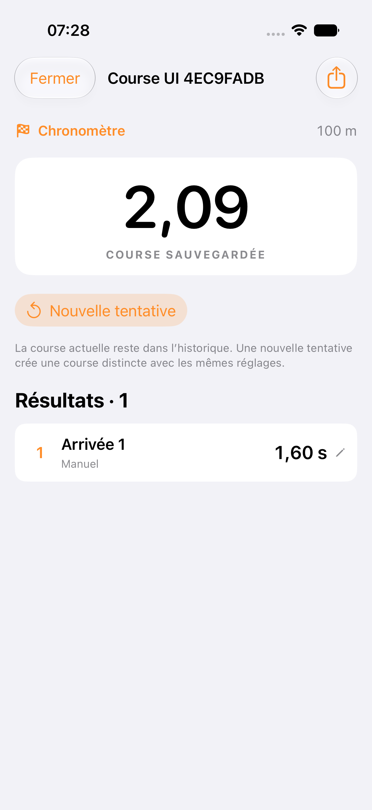
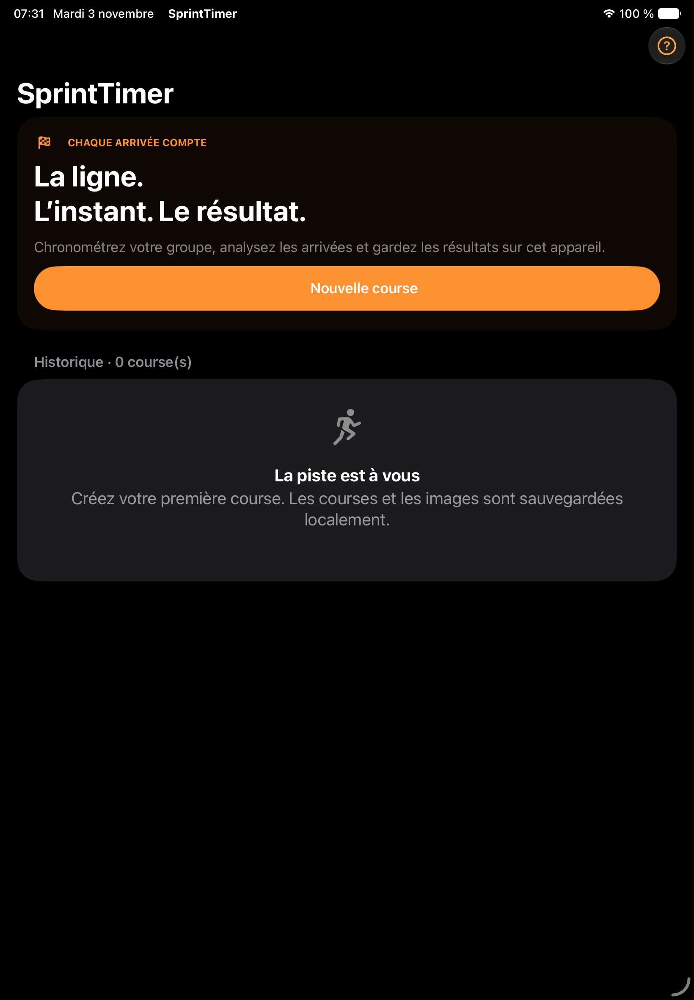

# SprintTimer

Application iOS de chronométrage sportif pour les entraînements et les cours d’EPS : départ, capture réelle de la ligne d’arrivée, analyse des concurrents et sauvegarde des résultats. L’interface est en français et s’adapte au mode clair ou sombre, sur iPhone et iPad.

Le dépôt [sprintJulien](https://github.com/rachid598/sprintJulien) contient une implémentation originale. Le projet Xcode, la cible principale et le nom de l’application sont **SprintTimer**. L’identifiant initial est `org.sprintjulien.SprintTimer`, distinct de celui de l’application commerciale de référence.

## Installer sur l’iPhone de Julien

Prérequis : un Mac avec **Xcode 16 ou ultérieur**, un iPhone ou iPad sous **iOS/iPadOS 17 ou ultérieur**, et les droits de lecture du dépôt privé.

```sh
git clone https://github.com/rachid598/sprintJulien.git
cd sprintJulien
open SprintTimer.xcodeproj
```

Dans Xcode, sélectionner la cible **SprintTimer**, choisir l’équipe Apple de Julien dans **Signing & Capabilities**, laisser la signature automatique activée, brancher son iPhone, le sélectionner puis cliquer sur **Run**. Aucun compte Apple du propriétaire du dépôt ni chemin de son Mac n’est imposé. Le seul package Swift est local au dépôt.

Voir [INSTALLATION.md](INSTALLATION.md) pour les étapes détaillées, le mode développeur, les problèmes de signature et l’export IPA. Aucun IPA installable n’est livré sans identité et profil de signature valides ; le script `scripts/export-ipa.sh` peut produire `dist/SprintTimer.ipa` sur un Mac configuré pour signer.

## Fonctionnalités implémentées

| Mode | Fonctionnement |
| --- | --- |
| **Photo-finish** | Caméra AVFoundation, extraction de bandes verticales BGRA, écriture de tuiles PNG sans perte et conservation de l’horodatage réel de chaque bande. Défilement, zoom, curseur, navigation par image et marquage des arrivées. |
| **Vidéo-finish** | Enregistrement continu H.264 avec horodatages, analyse image par image, ligne d’arrivée et score de mouvement associé à chaque image. |
| **Arrivée instantanée** | Détection de variation dans une zone autour de la ligne, temporisation et réarmement ; attribution de temps estimés et vidéo de contrôle. Filtre de présence humaine Vision facultatif. |
| **Chronomètre** | Course sans caméra avec marquage manuel de plusieurs arrivées. |

Les quatre modes partagent les départs manuel, avec bip programmé, après compte à rebours ou déclenché au microphone. Un décalage de départ permet le calibrage : une valeur positive ajoute du temps au résultat.

Les courses comprennent un nom, une date et une heure configurables, une distance prédéfinie — 30, 50, 100, 200 ou 400 m — ou personnalisée, et une liste de participants avec noms, dossards et couloirs. Les résultats sont classés par temps, attribuables ou modifiables après analyse et sauvegardés localement avec SwiftData et une copie JSON. L’historique permet de rouvrir les captures et de reprendre le marquage.

Le menu d’export propose CSV, PDF, photo-finish PNG annotée et fichiers de capture originaux via la feuille de partage iOS. Le CSV conserve des secondes à six décimales pour l’échange des données ; cet encodage ne certifie pas une précision à la microseconde. L’export PNG est un aperçu de taille limitée ; les tuiles originales et leurs temps restent séparément disponibles.

## Première course

1. Toucher **Nouvelle course**, choisir le mode, le départ et les participants, puis **Préparer**.
2. Pour un mode caméra, autoriser la caméra et stabiliser l’iPhone en portrait. Aligner la ligne orange avec la ligne d’arrivée réelle et cadrer tous les couloirs.
3. Démarrer le chronomètre. En départ microphone, armer la détection puis produire le signal ; ajuster d’abord le seuil au bruit ambiant.
4. Toucher **Capturer les arrivées** à l’approche des concurrents. Le départ et le début de la capture sont indépendants. Terminer la capture ou attendre sa durée maximale.
5. En photo ou vidéo, sélectionner l’image du franchissement avec le doigt, le curseur ou les flèches, choisir le participant et toucher **Marquer ce temps**. Toucher un résultat pour le corriger.
6. Exporter ou fermer la course : elle reste dans l’historique. **Nouvelle tentative** crée une autre course en conservant l’ancienne et ses réglages.

En mode chronomètre, utiliser **Marquer l’arrivée** pendant la course puis **Arrêter la course**. En arrivée instantanée, contrôler les détections et leur attribution dans les résultats et la vidéo.

Captures de l’application exécutée sur simulateur : course manuelle rouverte sur iPhone et accueil sombre sur iPad. Elles n’illustrent pas une capture caméra réelle.

 

## Précision et limites actuelles

Les mesures photo et vidéo utilisent les horodatages des échantillons de caméra convertis vers la même horloge hôte monotone que le départ. Elles ne sont pas calculées en divisant un numéro d’image par une cadence théorique. Une image perdue laisse une lacune temporelle ; l’analyse affiche les intervalles et ne fabrique pas d’image intermédiaire.

La cadence photo demandée peut atteindre 240 i/s si un format compatible est disponible. Le format choisi et la cadence moyenne effectivement enregistrée sont affichés séparément. Vidéo-finish et arrivée instantanée sont plafonnés à 60 i/s. Ces cadences, les pertes et la précision globale doivent encore être mesurées sur un appareil réel.

L’affichage au centième ne garantit pas une exactitude au centième. Réaction humaine, latence acoustique, exposition, rolling shutter et placement influent sur la mesure. Le bip utilise un instant de lecture programmé, pas une mesure de l’instant où le son atteint le coureur. L’arrivée instantanée estime l’entrée d’un mouvement dans une zone et peut manquer ou ajouter des passages ; elle ne sépare pas sûrement des coureurs côte à côte. Cette application n’est pas un système de chronométrage certifié.

La largeur des bandes et leur position se règlent **avant** la capture. Le zoom ultérieur change l’affichage ; il ne réextrait pas des bandes d’une autre largeur. Le mode photo conserve les bandes originales, sans vidéo complète permettant de refaire le cadrage. La capture doit rester au premier plan : le passage en arrière-plan arrête la course et finalise ce qui peut être conservé. Les points de reprise réduisent la perte de données après interruption ; une vidéo `.mov` non finalisée lors d’un arrêt brutal peut rester illisible.

Les commandes distantes, la synchronisation entre appareils, l’Apple Watch, les tours et l’import CSV de participants restent dans [ROADMAP.md](ROADMAP.md).

## Tests et compilation

```sh
# Calcul temporel, chronologie des images, pixels, détection et CSV
swift test --package-path Packages/SprintTimerCore

# Tests iOS sur simulateur et archive Release sans signature
bash scripts/ci-ios.sh
```

État de validation au 3 novembre 2026 :

| Vérification | Résultat établi |
| --- | --- |
| Tests du package Swift | 20 tests passés localement et en CI |
| Extraction réelle de bandes BGRA et rendu PNG | Vérifiés sur macOS, y compris le padding des lignes et les pixels ; aucune erreur |
| Application Debug pour simulateur | Compilation réussie avec Xcode bêta 27.0 |
| Tests unitaires iOS | 10 tests passés, 0 échec, sur simulateur iPhone 17 Pro / iOS 27 avec Xcode 27.0 |
| Test d’interface iOS | 1 test passé, 0 échec : création, départ, arrivée manuelle, sauvegarde et réouverture |
| Total des tests distincts | **31 tests passés : 20 cœur + 10 iOS + 1 interface** |
| Vidéo réellement encodée dans les tests | MOV de trois images à temps irréguliers, relu et extrait par horodatage ; test réussi |
| Archive Release pour appareil | `ARCHIVE SUCCEEDED` sur la source `8a1f4da`, archive non signée `dist/SprintTimer.xcarchive` |
| Accueil iPad sombre | Application lancée et affichage inspecté sur simulateur iPad (A16) / iOS 27 |
| CI finale | **Réussie** — [exécution 41591352456](https://github.com/rachid598/sprintJulien/actions/runs/41591352456) : tests Swift et iOS, archive Release et publication des artefacts. |
| Caméra, microphone, performance et installation sur iPhone réel | Non testés : aucun appareil disponible |
| Export d’un IPA signé | Non effectué : identité Apple Development détectée ; profil compatible et export signé encore à vérifier |

La [GitHub Action iOS](https://github.com/rachid598/sprintJulien/actions/workflows/ios.yml) réalise les tests Swift, les tests simulateur et une archive pour appareil avec `CODE_SIGNING_ALLOWED=NO`. Ses journaux et résultats sont conservés en artefacts. Une archive non signée vérifie la compilation pour appareil et doit être signée avant installation.

Le [rapport de vérification](VERIFICATION.md) précise les essais effectués, leurs résultats et les validations matérielles restantes. Les images des tests média sont synthétiques ; les opérations d’extraction, d’encodage, de décodage et de sauvegarde utilisent les moteurs réels de l’application.

## Organisation et données

- [ARCHITECTURE.md](ARCHITECTURE.md) : composants, horloges, moteur photo-finish et persistance.
- [INSTALLATION.md](INSTALLATION.md) : installation et dépannage Xcode.
- [ROADMAP.md](ROADMAP.md) : état fonctionnel et travaux restants.
- [VERIFICATION.md](VERIFICATION.md) : rapport de compilation, de tests et limites de la livraison.
- [Validation sur appareil](docs/DEVICE_VALIDATION.md) : protocole terrain et tableau de mesures à remplir.
- [Analyse approfondie de l’IPA et des outils](docs/DECOMPILATION.md) : 170 NIB examinés, limites du code chiffré.
- [Carte détaillée des interfaces](docs/INTERFACES.md) : contrôleurs, actions et écarts fonctionnels.
- [Analyse de la référence](docs/REFERENCE_ANALYSIS.md) : sources, preuves REA et limites de l’enquête.

Les noms, images, vidéos et résultats restent dans le stockage local de l’application jusqu’à un partage explicite. Aucun serveur, compte utilisateur ni service de télémétrie n’est requis. La suppression d’une course supprime aussi ses médias ; exporter les données à conserver avant une suppression ou une désinstallation.
