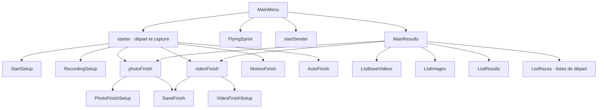

# Interfaces de SprintTimer 18.0 : carte extraite des ressources compilées

Analyse statique du 3 novembre 2026, fondée sur l’IPA fourni (`SprintTimer` 18.0, build 180). Cette carte apporte des faits supplémentaires pour une reconstruction plus fidèle. Elle décrit des ressources réellement décodées, sans prétendre avoir exécuté l’application commerciale ou retrouvé ses algorithmes.

## Résultat établi

Les **170 fichiers NIB** inventoriés ont été pris en compte dans trois lots REA. Ils représentent **86 unités logiques de ressources**, dont **84 paires** `runtime.nib` / `objects-13.0+.nib` et deux NIB ordinaires du LaunchScreen. Ces variantes ne sont pas 170 écrans : les deux fichiers d’une même paire ont ici les mêmes ensembles de textes et de sélecteurs d’actions, tandis que des objets et données d’adaptation peuvent différer.

Les liens `UIClassName` → `UINibName` donnent **43 enregistrements de contrôleurs**, correspondant à **42 couples distincts classe/vue** et 42 noms de classes distincts. `MainMenu` est sérialisé à la fois dans son NIB et dans celui du contrôleur de navigation ; son écran n’a pas été compté deux fois dans la synthèse. Une classe est le contrôleur UIKit du lancement. Ces nombres restent des comptes de ressources, sans déduire le nombre de vues créées dynamiquement.

Après choix d’une variante par unité logique, la carte contient 241 connexions d’actions, 97 sélecteurs distincts, 628 références d’outlets et 70 objets de modèles de segue. Les graphes REA bruts, qui incluent les variantes, comptent 13 740 nœuds et 3 952 arêtes. **Ces arêtes ne sont pas toutes des transitions de navigation** : beaucoup relient un contrôle à une action ou un outlet.

Les noms Swift de contrôleurs ont été rendus lisibles à partir de leur encodage de nommage (`_TtC11SprintTimer…`). Cette opération restitue un nom de classe ; elle ne décompile pas un corps de méthode.

## Provenance et frontière des preuves

| Lot | Preuve REA de décodage | Documents |
| --- | --- | --- |
| Premier lot | `ev_666d7ae0497b5c2b4463e620eba1027c1dcfa3c38794f2990532e02ba4f14fb2` | 64 |
| Deuxième lot | `ev_55ef350c0987e6213e6c01de9fed5e6147b19e5fd5f58d34cafeede98c575188` | 64 |
| Troisième lot | `ev_ee7d36b792e2e2adcbd2904c7ed41d4270f52de1fb18526a2fa420a54d129e8c` | 42 |

Les exports des lots sont cumulatifs. Les preuves ont été dédupliquées par `evidence_id`, puis les documents par leur chemin relatif. La table machine interne `work/rea/analysis/interface-map.json` conserve, pour chaque variante, le chemin, le SHA-256 complet, la preuve, les textes, contrôles, actions, outlets et modèles de segue reconnus. Les ressources originales et leurs charges binaires ne sont pas recopiées dans ce rapport ni dans le dépôt de reconstruction.

REA signale encore `truncated: true` et une couverture partielle : archives `UINib` embarquées non interprétées, hiérarchie non reconstruite et modèles privés de segue. Tous les fichiers ont été parcourus, mais tous leurs champs privés n’ont pas été compris. Les attributs explicites des objets de segue sont relevés ci-dessous comme faits sérialisés, même lorsque REA ne transforme pas le modèle entier en arêtes de navigation résolues.

Un sélecteur connecté dans un NIB **ne prouve ni l’existence ni le comportement du corps natif correspondant**. Les libellés, valeurs et états peuvent aussi être remplacés par le code à l’ouverture de l’écran. La géométrie finale, les contraintes effectivement appliquées et la visibilité à l’exécution restent à observer.

## Carte des parcours principaux

Les flèches suivantes représentent les destinations sérialisées dans les modèles de segue. Elles ne prouvent pas à quel moment une transition est autorisée ou déclenchée.

Le départ manuel, le départ sonore, le départ autonome, le départ distant et la correction Hand/Mic possèdent en outre des contrôleurs dédiés. Une carte des seuls modèles de segue ne montre pas toutes les présentations faites par code.

## Écrans et commandes observés

| Ensemble / contrôleur | Contrôles et réglages présents dans les ressources | Actions sérialisées remarquables | Sources NIB logiques |
| --- | --- | --- | --- |
| Accueil `SprintTimer.MainMenu` | Accès SprintTimer, Flying Sprint, Start Sender, Results et Guide | `gotoStart`, `gotoFlying`, `gotoStartSend`, `gotoResults` | `mainMenu.storyboardc/MainMenuVC.nib` ; vue `Uga-1O-0vu-view-y6O-SE-MLW.nib` |
| Course et caméra `starter` | Prévisualisation, démarrage/pause/arrêt de capture, accès aux réglages départ/capture, résultats et menu ; choix de lentille Wide/Tele et curseur de zoom | `zoomCamera:`, `switchDuoCam:`, `setSens:`, `captureOne`, `startRecording`, `pauseRecording`, `stopRecording`, `showPreview` | `mainMenu.storyboardc/UIViewController-3Da-Gj-cCo.nib` ; vue `3Da-Gj-cCo-view-I95-zd-pux.nib` |
| Réglages du départ `SprintTimer.StartSetup` | Groupes Starter/Self-Start/Start Sender ; Hand/Sound/Hand+Mic ; déclenchement Press/Release ; son, flash et départs échelonnés ; distance sonore, niveau micro et filtre de tir ; première/deuxième commande, voix, décalage et synchronisation distante | `changeStartMode:`, `changeClockMode:`, `showSoundPick`, `setGain:`, `showLangPick`, `changeVoiceSpeed:`, `startSync:` | `mainMenu.storyboardc/UITableViewController-e7v-M7-KnZ.nib` ; vue `e7v-M7-KnZ-view-hFF-A9-ns9.nib` |
| Départ manuel `manStart` | Grande commande de départ du chronomètre | `startTimer` | `mainMenu.storyboardc/manstart.nib` ; vue `04v-6F-skC-view-l3L-05-hph.nib` |
| Départ sonore `soundStart` | Niveau de départ, mode réglage et armement Active/Set Level | `setSoundLevel:`, `activateSound:` | `mainMenu.storyboardc/soundstart.nib` ; vue `BnE-hV-YzM-view-o4C-gt-vt7.nib` |
| Départ autonome `selfStart` | Lecture de commandes et libellé de réaction | `startPlaying` | `mainMenu.storyboardc/selfstart.nib` ; vue `Wtv-9o-y4j-view-hly-Wo-Wvs.nib` |
| Correction audio `SprintTimer.HandMic` | Lecture/pause, amplification, recherche du pic, décalage et choix Apply Correction / No Correction | `playSound`, `pauseSound`, `amplifySound`, `gotoMax`, `closeManSound:` | `mainMenu.storyboardc/manmic.nib` ; vue `z62-yu-jOD-view-Q2Z-3p-jpo.nib` |
| Départ distant `ssStart`, `startSender`, `remoteRecording` | États actif/passif, départ manuel de secours, armement sonore distant et commandes de capture distante | `backUpStart`, `activateRemoteSound:`, `activateVideo`, `startRecording`, `stopRecording`, `closeRemote` | `ssstart.nib`, `UIViewController-6co-fd-kbE.nib`, `remoterecording.nib` dans `mainMenu.storyboardc` |
| Capture `SprintTimer.RecordingSetup` | Photo/Video/Live ; sauvegarde sur Human/All/Manual/Motion ; choix FPS 5/10/15/30/60 sérialisés ; début différé, durée, arrêt au numéro de passage, remise à zéro au premier passage ; auto-finish local/iCloud/DropSS ; direction, largeur de bande, faible lumière, HD, temps de tour/total, voix/bip, réarmement et appareils multiples | `changeFinishMode`, `changeDetectionMode`, `changeSlice`, `setCapReset` | `mainMenu.storyboardc/UITableViewController-qgU-YC-Nh9.nib` ; vue `qgU-YC-Nh9-view-1vT-qM-MqX.nib` |
| Analyse photo `photoFinish` | Terminer, sauvegarder, réglages, recadrage gauche/droite, défilement, marquage et changement de temps/différence | `hideFinish:`, `macCrop:`, `slideScroll`, `slideScrollDown`, `slideScrollUp`, `pickMarks`, `changeDiff` | `mainMenu.storyboardc/UIViewController-pAb-Wp-IAG.nib` ; vue `pAb-Wp-IAG-view-cCr-Gs-3CV.nib` |
| Photo, réglages `SprintTimer.PhotoFinishSetup` | Direction, largeur des bandes, affichage centième/millième, détection de personnes | `changeSlice`, `showInfo:` | `mainMenu.storyboardc/UITableViewController-uIW-r6-Shc.nib` ; vue `uIW-r6-Shc-view-rqe-6B-G2N.nib` |
| Analyse vidéo `videoFinish` | Curseur, pas gauche/droite, marque, temps/différence, commandes DUAL et repères L/R, sauvegarde et réglages | `stepLeft`, `stepRight`, `scrollaFilm`, `pickMarks`, `changeDiff`, `switchDouble` | `mainMenu.storyboardc/UIViewController-rO5-Sp-3zx.nib` ; vue `rO5-Sp-3zx-view-05X-Kf-eRE.nib` |
| Vidéo, réglages `SprintTimer.VideoFinishSetup` | Dual Mode, direction, temps/heure du jour et détection des numéros | `changeDirection`, `changeTOD`, `changeOCR` | `mainMenu.storyboardc/UITableViewController-iTR-Gf-kbi.nib` ; vue `iTR-Gf-kbi-view-idB-Tu-Cxe.nib` |
| Arrivées / liste `SprintTimer.MarkList` | Colonnes Num/Lane/Name/Time, commandes de marque et SPLIT | `setMark`, `setSplit`, `sortList:` | `mainMenu.storyboardc/mark_list.nib` ; vue `CDo-Wa-61c-view-eqW-xY-sVz.nib` |
| Sauvegarde `SprintTimer.SaveFinish` | Nom de course, renommer la liste ; résultats CSV/LIF/PDF ; image entière/recadrée, échelle 100/50/33 %, lignes temporelles 0,1 s ou marques ; frames images/vidéo, toutes/marquées ; vidéo source local/iCloud/AirDrop | `updateText:`, `saveFinish` | `mainMenu.storyboardc/UITableViewController-c7P-wa-4mt.nib` ; vue `c7P-wa-4mt-view-A4J-lY-N3U.nib` |
| Résultats `SprintTimer.MainResults` | Sous-listes images photo, vidéos sources, précédente course, vidéos d’arrivée, listes de départ et listes de résultats | Modèles `showBaseVideos`, `showImageList`, `showResultsLists`, `showStartLists` | `mainMenu.storyboardc/UITableViewController-Qaf-Mh-PkR.nib` ; vue `Qaf-Mh-PkR-view-296-sA-gmx.nib` |
| Résultat individuel `SprintTimer.RaceResult` | Ouverture d’image d’arrivée ou de vidéo source | `openImage`, `openBaseVideo` | `mainMenu.storyboardc/Ra.nib` ; vue `gbJ-gk-EHb-view-XyY-SH-miD.nib` |
| Export `SprintTimer.SetupExport`, `SprintTimer.SetupCSV` | Résultats vides DNF, résolution 1/100 ou 1/1000, format h:m:s ou secondes ; séparateurs décimal/champ, tabulation, guillemets et extension txt/csv | Contrôles statiques ; les changements peuvent être gérés par callbacks de tableau non reconnus comme actions NIB | `mainMenu.storyboardc/UITableViewController-5Ot-gP-K5m.nib` ; `FlyingSprint.storyboardc/UITableViewController-bW3-v5-Hok.nib` |
| Vue paysage `landFinish` | Recadrage gauche/droite et message indiquant une orientation paysage particulière | `setCrop:`, `slideScroll:` | `mainMenu.storyboardc/landfin.nib` ; vue `M4j-5i-yrc-view-JhF-s1-BrG.nib` |

Les chemins de la table désignent les unités logiques. Pour la plupart, les fichiers exacts finissent par `/objects-13.0+.nib` et `/runtime.nib`. Leurs empreintes complètes figurent dans la carte machine.

Les chaînes d’exemple `0.37`, `1.5`, `12`, des temps de démonstration et des intitulés comme « Reaction: 100 ms » sont des **valeurs archivées**. Elles ne sont pas des mesures obtenues pendant l’analyse, ni la preuve des valeurs réellement appliquées au lancement.

## Modules complémentaires réellement présents dans les ressources

- **Flying Sprint** dispose de ses propres écrans `FlyingSprint`, `FlyingSetup`, `FlyingResults`, `FlyingTour` et `SetupCSV` dans `FlyingSprint.storyboardc`. Les réglages sérialisés couvrent suivi d’objet/personne, distances 5/10/20 m, longueur de foulée, choix Wide/Standard/Tele, activation automatique, annonce vocale, vitesse de voix, instantané, sensibilité et réduction du scintillement 50/60 Hz. Les résultats comportent partage et effacement. Ce sont des contrôles observés, sans analyse de l’algorithme de suivi.
- **Création et listes** : `CreateRace` contient noms/numéros, nom de course, nom d’épreuve, série, tour et identifiant d’épreuve ; `ListRaces` et `ListResults` ont sélection, tout sélectionner, annulation, suppression/export. `ImportRaces` existe, mais son contenu dynamique n’est pas établi par les textes statiques.
- **Médias** : `ListBaseVideos`, `ListImages`, `AutoFinish` et `PostImage` sont présents. `PostImage` contient des commandes d’ouverture et de partage de lien ; les requêtes réseau et le service effectivement utilisé n’ont pas été observés.
- **Guides** : `Guide`, `GuideList`, `WebView`, `PhotoFinishGuide`, `VideoFinishGuide` et `FlyingTour` sont présents. Ils renvoient à des guides et tutoriels locaux/externes ; la liste comprend une entrée française.
- **Commerce** : `PurchasePro` contient achat, abonnement et restauration. La présence de ces contrôles ne justifie pas de recréer une restriction commerciale dans notre application. Les données du compte App Store n’ont pas été lues.

## Ce que la carte établit sur les interactions

Le contrôleur `starter` référence explicitement les destinations photo, vidéo, motion, auto-finish, départ, enregistrement et résultats. L’analyse photo référence ensuite `PhotoFinishSetup` et `SaveFinish` ; l’analyse vidéo référence `VideoFinishSetup` et la même sauvegarde. Il s’agit donc de réglages et d’opérations accessibles depuis les écrans d’analyse, pas seulement d’options présentes au premier lancement.

La commande `changeSlice` dans les réglages photo est reliée à un écran accessible après l’analyse photo. Les guides embarqués décrivent l’effet de cette largeur sur le rendu. Cela permet d’en faire une exigence de parité fonctionnelle ; l’implémentation native du recalcul reste inconnue dans ce binaire protégé.

Le guide vidéo embarqué décrit le mode DUAL comme une superposition de deux images voisines avec réglage de deux lignes. Les ressources d’analyse contiennent bien DUAL, L/R et `switchDouble`. Le mécanisme attendu est donc corroboré par deux types de ressources ; sa précision réelle n’a pas été mesurée.

Les actions press/release et les gestes ne sont pas toutes représentées de la même manière. Les masques d’événements reconnus sont conservés dans la carte machine. Les longs appuis, doubles taps et raccourcis indiqués dans les guides restent des descriptions de l’auteur tant qu’un parcours tactile réel ne les a pas vérifiés.

Les objets de contenu des boutons et les tableaux internes ne sont pas tous projetés en nœuds reliés : le rapport rapproche parfois un libellé et un sélecteur présents dans le même NIB sans prétendre avoir résolu toute la chaîne contrôle→texte→action.

## Écarts établis avec la reconstruction actuellement livrée

La comparaison suivante repose sur les sources de ce dépôt et sa feuille de route. Les lignes décrivent la présence d’options dans la référence et leur couverture actuelle dans notre code, sans attribuer une fiabilité mesurée aux options commerciales.

| Sujet | Référence extraite / documentée | Reconstruction actuelle | Conséquence pour la fidélité |
| --- | --- | --- | --- |
| Structure générale | Accueil séparé, poste de départ/capture puis réglages spécialisés et résultats médias | Accueil avec historique puis création de course et écran de déroulement unifié | Parcours différent, volontairement moderne ; pas une reproduction des écrans |
| Départ Hand+Mic | Départ manuel complété par relecture audio, amplification et correction au pic | Manuel ou déclenchement au seuil ; aucune relecture de signal après la course | Fonction manquante |
| Départ autonome | Première/deuxième commande, voix, intervalles et sons sélectionnables | Compte à rebours puis bip synthétisé | Fonction simplifiée |
| Départ manuel | Choix Press/Release, son, flash, départ échelonné | Commande manuelle et bip dans des modes distincts | Options de parité manquantes |
| Capture | Pause, début automatique à un temps, arrêt au numéro de passage, source à réouvrir, lentille/zoom | Départ de capture manuel, arrêt manuel ou durée maximale ; géométrie de ligne réglable, caméra arrière principale | Plusieurs commandes absentes |
| Photo après capture | Direction, largeur modifiable, différentiel/absolu, 1/1000, recadrage et vue paysage spécialisée | Bandes déjà extraites, largeur fixe après capture, zoom visuel et marquage ; pas de recalcul ni recadrage | Écart central pour une reconstruction fidèle |
| Vidéo | Mode DUAL avec L/R, heure du jour et détection des numéros proposés | Vidéo continue et navigation image par image, sans DUAL/OCR/heure du jour | Fonctions d’analyse manquantes |
| Live / passages | Réarmement, temps total/tour, arrêt par nombre, remise à zéro au premier passage ; contrôle manuel/personne/mouvement dans les réglages | Détection estimée de mouvement et filtre Vision facultatif ; un résultat attribué par participant | Parité des tours et des modes de détection non atteinte |
| Marquage | Liste Num/Lane/Name/Time, tri et SPLIT | Sélection de participant puis marquage et correction ; classement final | Logique de consultation et de passages différente |
| Historique / sources | Listes distinctes d’images, vidéos sources, listes de départ et résultats ; import | Courses unifiées avec JSON, tuiles ou vidéo ; pas de restauration/import des originaux | Réanalyse et échanges plus limités |
| Export | Formats paramétrables, DNF, LIF, choix images/frames, réduction/recadrage, lignes temporelles et services source | CSV fixe, PDF, aperçu PNG borné et partage de fichiers | Socle présent, options plus limitées |
| Distant / Watch / Flying Sprint | Contrôles et modules dédiés dans les ressources et guides | Différés | Modules absents |

## Travail concret recommandé pour réduire les écarts

1. Établir une spécification de parité des parcours cœur à partir de `starter`, `StartSetup`, `RecordingSetup`, `photoFinish`, `videoFinish`, `MarkList` et `SaveFinish`. Garder une identité graphique originale tout en retrouvant les opérations et états.
2. Prioriser la conservation d’une source photo plus large ou d’une vidéo source horodatée afin de recalculer la largeur et la direction après capture. La présence d’un curseur de largeur dans l’interface ne suffit pas : le stockage et le moteur doivent rendre le réglage effectif.
3. Ajouter pause de capture, début programmé, recadrage, modes temps absolu/différence et structure de marquage à plusieurs passages. Chaque changement doit conserver les horodatages des images effectivement utilisées.
4. Implémenter et tester séparément Hand+Mic, le mode vidéo DUAL, les commandes vocales et les options d’export. Les tests synthétiques vérifient les calculs ; un essai matériel reste nécessaire pour les latences, l’alignement et les franchissements.
5. Relever les écrans de l’original sur un appareil accessible pour vérifier géométrie, états visibles, gestes et conditions de navigation. Le NIB ne prouve pas tous ces éléments.

Aucun corps de méthode natif n’a été décompilé dans ce travail de cartographie. Les tentatives complémentaires `ipsw class-dump` et `swift-dump`, menées par le parent, ont rencontré respectivement des noms illisibles et une erreur de lecture de métadonnées Swift. Elles n’ont pas produit un ensemble d’en-têtes utilisables. Les corps chiffrés et les résultats mal formés ne sont pas utilisés comme des preuves d’algorithme.

## Nouvelle observation visuelle à rattacher à la carte

Les illustrations embarquées `startModes.png` et `ResultsManager.png`, qui n’étaient pas affichables lors de la première analyse, ont été converties depuis le format PNG optimisé iOS par le parent avec `pngcrush`, puis examinées. L’observation rapportée montre une interface bleue, un grand départ central et une barre inférieure de réglages, menu, résultats et prévisualisation. Cela complète les intitulés des ressources ; il s’agit d’illustrations embarquées, et non d’une capture de fonctionnement obtenue sur un iPhone pendant cette enquête.
